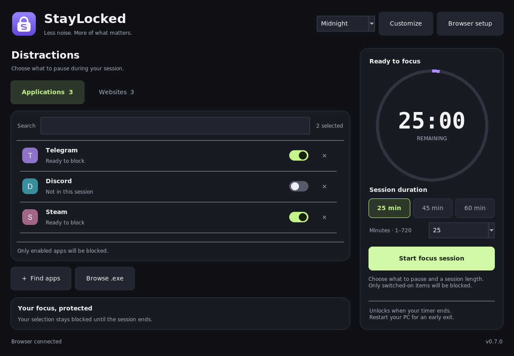
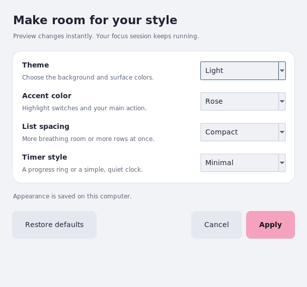

# StayLocked 0.7.1 — Reliable upgrades and session Stop protection

Windows 10/11 x64. Pause selected apps and sites until your timer ends or Windows restarts. **REMAINING** displays the countdown. The Windows service owns both the timer and the restrictions, independently of the desktop window. The redesigned workspace has searchable app and website lists, a circular timer, quick durations and saved appearance customization.

This is a complete source project with Windows build scripts, not a precompiled Windows EXE. The Windows service/installer must be verified on Windows before wider distribution. See VERIFICATION-0.7.1.md.

## Установка обновления

1. Перезагрузи Windows, чтобы завершить старую сессию. Закрой старый StayLocked через трей и браузеры с расширением перед установкой.
2. Распакуй этот архив в **новую папку**, например `D:\StayLocked-0.7.1`. Не смешивай файлы разных версий.
3. Дважды нажми **Build-Installer.cmd**. Нужны Python 3.12–3.14 x64 и Inno Setup 6.3+ / 7 на компьютере сборки. Скрипт установит зависимости в отдельную `.build-venv`, выполнит Python-тесты и соберёт все EXE + установщик.
4. Запусти `release\StayLocked-Setup-0.7.1-x64.exe` обычным двойным кликом и прими UAC. Он установит программу в `C:\Program Files\StayLocked`, добавит видимую службу **StayLocked Focus Service** с ручным запуском. Python другу не нужен: отправляй этот один установщик.
5. Открой установленный StayLocked из меню Пуск. Нажми **Browser setup**, выбери браузер и выполни инструкции. Старая папка расширения должна быть заменена на папку установленной версии; проверь номер **0.7.1**. Если папка уже правильная, достаточно обновить расширение на странице расширений.

В 0.7.1 исправлено обновление поверх старой службы и добавлен отказ от обычной команды Stop во время сессии; интерфейс 0.7.0 сохранён. Служба и протокол совместимы с 0.6.1. Если переходишь с 0.6.0 или более ранней версии, обязательно обнови всю установку: в 0.6.1 была исправлена ошибка обмена со службой `CancelIoEx`.

## Таймер

В **Session duration** выбери или введи от 1 до 720 минут. По умолчанию 25. После старта длительность нельзя менять; отсчёт и разблокировка выполняются самой службой даже без окна и расширения. Перезагрузка завершает сессию раньше. Сон/гибернация учитываются в длительности; изменение часов Windows не продлевает таймер.

Пункт **Until restart** оставлен как отдельный необязательный режим без таймера. Обычный режим по умолчанию с таймером.

Старая версия устанавливалась для одного пользователя в LocalAppData. Новая устанавливается для компьютера в Program Files, поэтому старая запись может остаться отдельно в списке установленных приложений. Удалить её можно после проверки новой версии; настройки в `%LOCALAPPDATA%\FocusLock` сохраняются. Удаление старого расширения не требует очистки истории, профиля или настроек поиска.

В этой версии **обязателен установщик**: запуск одного EXE из `dist` не устанавливает службу. Исходный интерфейс может работать с уже установленной службой; неподготовленное приложение покажет `INSTALL SERVICE TO START`.

## Браузеры

| Браузер | Страница | Что загрузить из папки установленного приложения |
|---|---|---|
| Opera / Opera GX | `opera://extensions` | Developer mode → Load unpacked → `extension` |
| Chrome | `chrome://extensions` | Developer mode → Load unpacked → `extension` |
| Edge | `edge://extensions` | Developer mode → Load unpacked → `extension` |
| Yandex | `browser://extensions` | Режим разработчика → Загрузить распакованное → `extension` |
| Firefox 140+ | `about:debugging#/runtime/this-firefox` | Load Temporary Add-on → `extension-firefox\manifest.json` |

Firefox: разреши доступ к сайтам, если браузер попросит. Это **временная тестовая установка**, она удаляется при закрытии Firefox. Для постоянного распространения нужна подпись Mozilla через AMO, в том числе для распространения вне магазина. Подпись и публикация ещё не выполнены. Защита подписи не отключается.

В popup должно быть `Connected to desktop`, а во время сессии — оставшееся время (либо `Until Windows restarts` в режиме без таймера). Расширение не меняет поисковую систему, новую вкладку или профиль браузера. Поиск с `youtube.com` в тексте запроса остаётся доступным, если сам поисковик не выбран для блокировки.

## Новый интерфейс и кастомизация



- Отдельные списки приложений и сайтов с поиском, иконками и счётчиками. Прокрутка появляется при переполнении.
- Быстрые длительности **25 / 45 / 60 минут**, ручной ввод **1–720 минут** и отдельный режим **Until restart**.
- **Customize**: четыре темы, шесть цветов акцента и вариант Theme default, плотность Comfortable / Compact, таймер Ring / Minimal.
- Изменения оформления видны сразу. **Apply** сохраняет, **Cancel** возвращает прежний вид, **Restore defaults** показывает стандартный вариант перед сохранением.
- На Windows иконки читаются из EXE без запуска приложения; при отсутствии иконки используется монограмма. На скриншотах тестового Linux-окружения показаны монограммы и демонстрационные приложения.
- **Ctrl+F** переводит фокус в поиск; **Space** переключает выбранные строки, **Delete** удаляет, **Ctrl+A** выделяет видимые строки. Выделение и включение блокировки независимы.
- Путь выбранного приложения показывается внизу списка. Клик по фону снимает выделение.
- Во время сессии переключатели, удаление и длительность заблокированы; поиск и оформление остаются доступны. Закрытие окна сворачивает его в трей.



Списки и их включение остаются в `%LOCALAPPDATA%\FocusLock\config.json` (schema 3). Оформление хранится отдельно в `appearance.json`; старый файл с одним полем theme поддерживается. Обновление внешнего вида не меняет сессию или её крайний срок.

## Проверки и сборка на GitHub

Workflow **Windows build and checks** проверяет Python-код, настоящее Tk-окно и нативное чтение иконок, затем собирает полный установщик. В **Actions → успешный запуск → Artifacts → StayLocked-0.7.1-Windows** находится ZIP с `StayLocked-Setup-0.7.1-x64.exe`. Архив распаковывается перед запуском установщика. Это сборка исходников выбранной ветки, а не автоматическая публикация релиза.

В папке `release` пока остаётся прежний установщик **0.6.1**. Для нового интерфейса используй артефакт успешной Windows-сборки или запусти `Build-Installer.cmd` на своём Windows-компьютере.

Для локальной проверки из корня проекта:

```text
python -m unittest discover -s tests -v
python tools/check_ui.py --screenshots ui-checks
```

Вторая команда требует графического окружения и использует временные настройки и имитацию службы. Настоящая блокировка не запускается. Проверка ОС и установки на Windows описана в [VERIFICATION-0.7.1.md](VERIFICATION-0.7.1.md).

## Как теперь держится блокировка

Раньше файлы и сетевые фильтры принадлежали пользовательскому процессу. Теперь их держит **отдельная Windows-служба LocalSystem**, запущенная диспетчером служб. Интерфейс отправляет список, а затем только запрашивает состояние. Закрытие/завершение `StayLocked.exe` и перезапуск интерфейса не отправляют службе команду остановки. Расширение имеет только чтение статуса.

Служба стартует по запросу Start Focus Mode, без автозапуска при загрузке Windows, задач планировщика и автоматического восстановления процесса. Состояние сессии и крайний срок хранятся только в памяти службы. Истечение таймера или перезагрузка снимают временные ограничения; следующая сессия начинается только по твоему запросу. Выход из учётной записи сам по себе службу не останавливает.

Во время STARTING/ACTIVE служба не принимает обычную команду Stop (в том числе через вкладку служб Диспетчера задач). После таймера Stop снова доступен. Перезагрузка/выключение работают во время сессии. Установщик использует новый временный помощник, запрашивает минимальные права и исправляет только известную старую запись BA без SERVICE_STOP; чужие запреты и неизвестные политики он не переписывает.

**Это не абсолютная защита от администратора.** Владелец Windows с повышенными правами может принудительно завершить её процесс, в том числе через Диспетчер задач с повышенными правами. Обычная остановка и удаление во время активной сессии отклоняются. Аварийное завершение процесса администратором остаётся возможным; например, из повышенного PowerShell: `Stop-Process -Name StayLockedService -Force`. Диспетчер задач, выключение ПК и Safe Mode не блокируются. Обычное завершение *окна StayLocked* отделено от остановки службы; обещания «вообще невозможно закрыть» здесь нет.

Служба принудительно завершает только выбранные, проверенные EXE текущего пользователя после подтверждения в Start. Несохранённые данные в этих приложениях могут потеряться. Если выбранный файл запущен другим пользователем, старт отменяется. Приложения в Windows/каталогах StayLocked, критические процессы и инструменты восстановления защищены от выбора.

Windows IP-фильтрация — дополнительный экспериментальный слой, действует для всех пользователей ПК на выбранных публичных IP и web-портах 80/443. Общие IP могут затронуть другие сайты; VPN, новые CDN/IP, кэш, выключенное расширение и копии EXE не дают оснований обещать непреодолимую блокировку. Для точной блокировки доменов нужно подключённое расширение. Ни hosts, ни постоянные политики запуска не изменяются.

## Запуск исходников после установки службы

В PowerShell **из папки проекта**:

```powershell
py -m venv .venv
.\.venv\Scripts\python.exe -m pip install -r requirements.txt
```

Затем запусти `Start-StayLocked.cmd` или в PowerShell с повышенными правами:

```powershell
.\.venv\Scripts\python.exe main.py
```

GUI пока требует администратора для старта сессии. Используй свою же учётную запись при UAC: запуск от другого Windows-пользователя даст его настройки/SID. Browser setup регистрирует мост для пользователя, который его запустил.

## Структура

```text
StayLocked/
  main.py, entrypoint.py             Интерфейс
  service_entrypoint.py              Отдельный EXE службы
  focuslock/
    ui.py, widgets.py, theme.py      Окно, списки, темы
    service_core.py                  Сессия в памяти, один владелец
    service_client.py, service_ipc.py  Локальный канал к службе
    service_admin.py                 Установка/удаление службы
    worker.py, winapi.py, force_close.py  Файловые блокировки и завершение EXE
    network.py, wfp.py               Временные сетевые фильтры
    native_host.py, extension_setup.py  Мост и мастер браузеров
    storage.py, preferences.py       Сохранение списков/темы
    discovery.py, app_picker.py      Поиск приложений
  extension/                        Chromium, Opera, Edge, Yandex
  extension-firefox/                Firefox, генерируется из общего кода
  tools/                            Сборка и проверки
  tests/                            Автоматические тесты
  installer/StayLocked.iss           Inno Setup
  assets/                           Значки
```

Подробности протокола и объяснение кода: ARCHITECTURE.md. Проверка на своём ПК: VERIFICATION-0.7.1.md.
